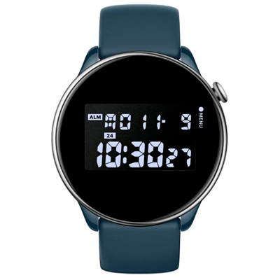

# X-Shock 2 Watchface

Watchface for round Zepp OS watches.

## Description

A digital watchface that recreates the design of one of the Casio G-Shock variants, with large segmented time digits and a compact date row. Additional different status indicators (alarm, low battery, and disconnection). Includes full AOD support.

**Language:** English

**Reference:** Casio G-Shock watches design

## Download ⏬

See the [installation instructions](../../../README.md#installing-a-watchface) to download and install the watchface.
